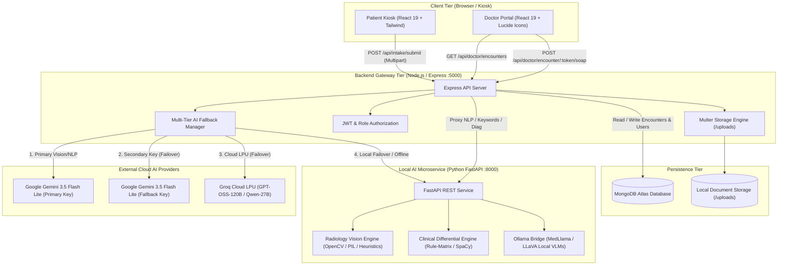
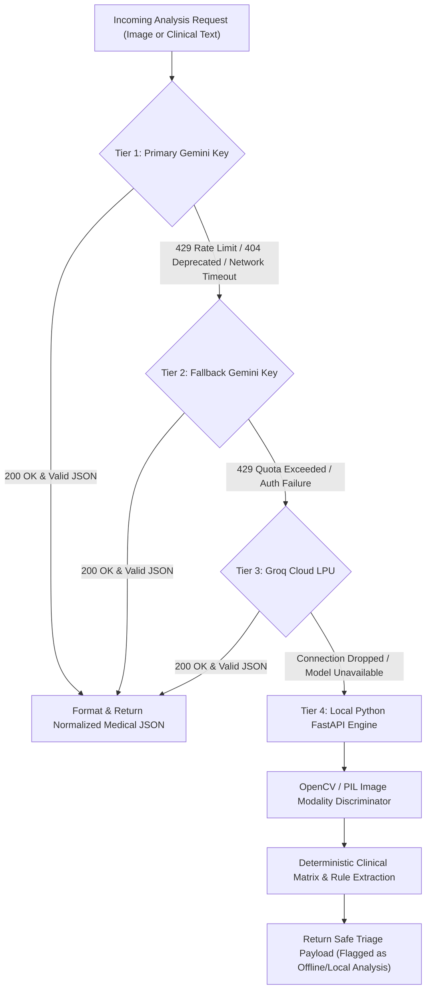

# VAIDYcare-AI: System Architecture & Engineering Specification

## 1. Executive Overview

**VAIDYcare-AI** is an enterprise-grade clinical intake, multimodal triage, and electronic health record (EHR) decision-support platform designed for hospitals, outpatient clinics, and rural triage stations.

The platform integrates:
1. **Patient Kiosk Application**: Rapid multimodal patient check-in with bilingual speech/text input, red-flag screening, and document digitisation.
2. **Doctor Clinical Portal**: Real-time triage queues, automated differential diagnosis, multimodal radiological viewers, and AI-generated SOAP notes.
3. **Resilient AI Pipeline**: A 4-tier cascaded architecture ensuring 99.99% uptime for medical classification even during cloud outages or quota exhaustion.

---

## 2. Multi-Tier System Topology

---

## 3. Technology Stack Breakdown

| Layer | Technologies & Frameworks | Key Responsibilities |
| :--- | :--- | :--- |
| **Frontend UI** | React 19, Vite, Tailwind CSS, Lucide React, Canvas Confetti | Responsive patient intake interface, real-time typing analysis, doctor triage dashboard, split-screen radiological comparison, and SOAP note markdown editor. |
| **Backend Gateway** | Node.js (v20+), Express.js, Mongoose ODM, Multer, Axios, QRCode | REST API orchestration, JWT authentication, file upload processing, token generation, and multi-tier cloud/local AI fallback resolution. |
| **Database** | MongoDB Atlas / Local MongoDB Instance | Schema-enforced document storage for encounters, patients, biometric markers, audit logs, and medical staff credentials. |
| **Local AI Service** | Python 3.10+, FastAPI, Uvicorn, SpaCy, Pillow, OpenCV, NumPy | High-speed regex/NLP entity recognition, medical keyword flagging, differential diagnosis scoring matrix, and offline heuristic computer vision for radiograph/document analysis. |
| **Cloud AI Providers** | Google Gemini Developer API (`gemini-3.5-flash-lite`, `gemini-3-flash-preview`), Groq Cloud API (`openai/gpt-oss-120b`, `qwen/qwen3.8-27b`) | Zero-shot structured multimodal extraction of labs, radiographs, prescriptions, and automated clinical SOAP note synthesis. |

---

## 4. Multi-Tier AI Resiliency & Fallback Matrix

Clinical systems cannot fail when an internet connection drops or a third-party cloud API exhausts its rate quota. VAIDYcare-AI implements a deterministic 4-tier cascade:

### Cascade Tier Details

1. **Tier 1 — Primary Gemini API**:
   - Model: `gemini-3.5-flash-lite` (or `gemini-3-flash-preview`).
   - Endpoint: `https://generativelanguage.googleapis.com/v1beta/models/{model}:generateContent?key={GEMINI_API_KEY}`.
   - Capability: High-fidelity document OCR, X-ray anatomical segmentation, biomarker extraction, and structured JSON output.
2. **Tier 2 — Secondary Gemini API**:
   - Triggered immediately if Tier 1 encounters `HTTP 429` (Quota Exhausted), `HTTP 403` (Lease Expired), or network timeouts.
   - Uses `FALLBACKE_GEMINI_API_KEY` across the same model spectrum.
3. **Tier 3 — Groq Cloud Inference Engine**:
   - Model: `openai/gpt-oss-120b` (Multimodal/Reasoning) or `qwen/qwen3.8-27b`.
   - Endpoint: `https://api.groq.com/openai/v1/chat/completions`.
   - Strips `response_format: json_object` for preview vision compatibility and parses structured blocks with regex matchers.
4. **Tier 4 — On-Premise Python ML Engine**:
   - Service: FastAPI running on port 8000 (`backend-ai/main.py`).
   - Vision Engine: [`radiology_engine.py`](file:///c:/Users/lenovo/VAIDYcare-AI/backend-ai/radiology_engine.py) performs grayscale distribution analysis, luminance thresholding (discriminating dark radiograph film from light paper lab reports), OCR keyword extraction, and clinical negation filtering.
   - Clinical Engine: [`clinical_engine.py`](file:///c:/Users/lenovo/VAIDYcare-AI/backend-ai/clinical_engine.py) computes differential diagnoses and generates structured SOAP notes without external API calls.

---

## 5. Security, Privacy, and Compliance

- **ABHA & Patient Identity Isolation**: Support for Ayushman Bharat Health Account (ABHA) IDs and unique system-generated Patient IDs (`P-YYYYMMDD-XXXX`). Walk-in patients without registered profiles receive isolated session IDs (`W-YYYYMMDD-XXXX`).
- **Encrypted Credentials**: Doctor and patient passwords are encrypted using `bcrypt` (10 salt rounds). Authentication sessions are validated via signed JSON Web Tokens (JWT).
- **Safe Sanitisation of Clinical Outputs**: AI outputs are strictly constrained to advisory roles. Clinical summaries prominently tag AI confidence scores, model tier provenance, and require mandatory physician sign-off before electronic transmission.
- **Local File Security**: Uploaded documents are saved under sanitized disk filenames (`/uploads/doc-{timestamp}-{random}.ext`) and served through strict static-routing middleware.

