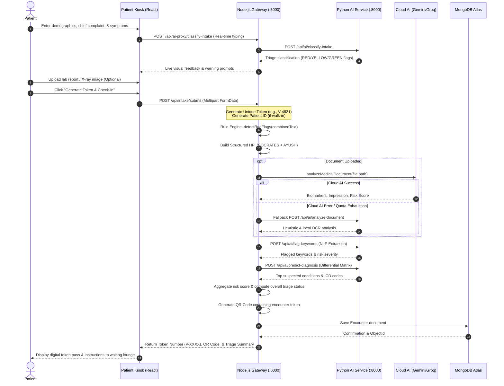
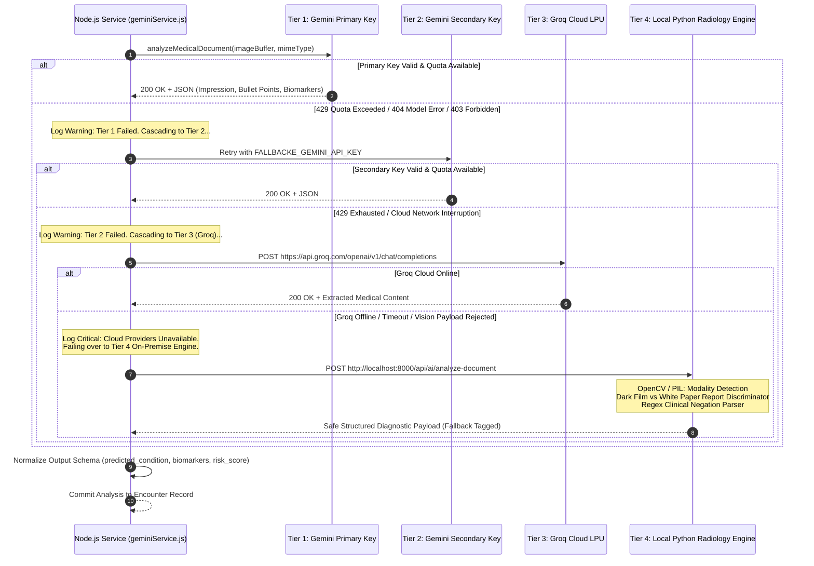
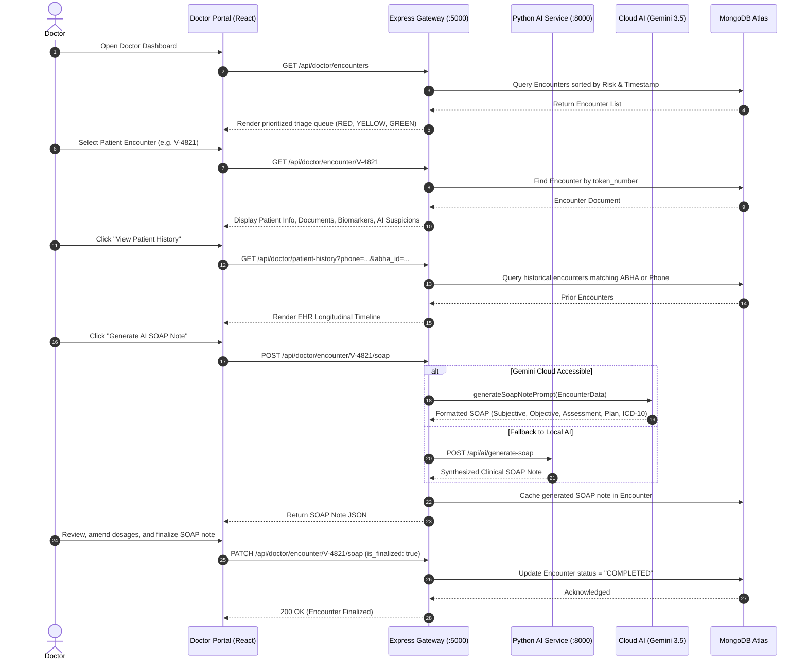
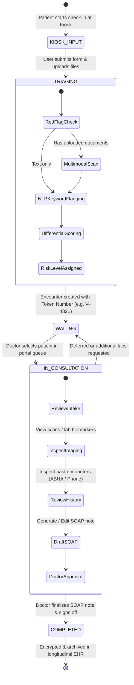

# VAIDYcare-AI: Clinical Workflows & State Machine Diagrams

This document outlines the end-to-end operational workflows and data flow pipelines within VAIDYcare-AI.

---

## 1. Patient Kiosk Intake & Triage Flow

This sequence depicts a patient arriving at an outpatient or emergency intake kiosk, submitting their demographic information, chief complaints, symptoms, and existing paper or radiographic documents.

---

## 2. Multimodal Scan Analysis & Multi-Tier AI Cascade

This sequence illustrates the resilient 4-tier decision cascade when an X-ray, CT scan, MRI, or blood work PDF/image is ingested into the system.

---

## 3. Clinical Diagnostic & SOAP Generation Flow

This sequence demonstrates how a physician interacts with the Doctor Portal to review patient triage queues, examine diagnostic imaging, inspect past electronic health records (EHR), and generate or edit clinical SOAP notes.

---

## 4. Patient Encounter Lifecycle State Machine

The following state machine governs the status transitions of a patient encounter from kiosk check-in to consultation completion:

